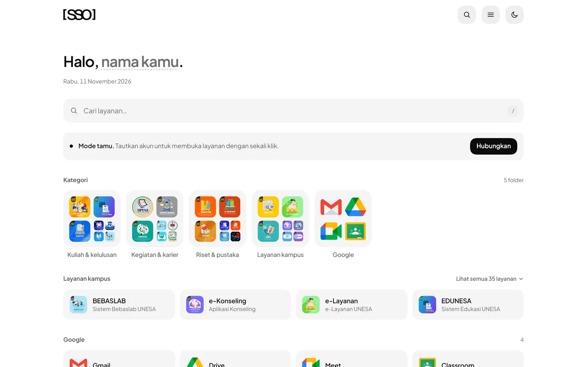
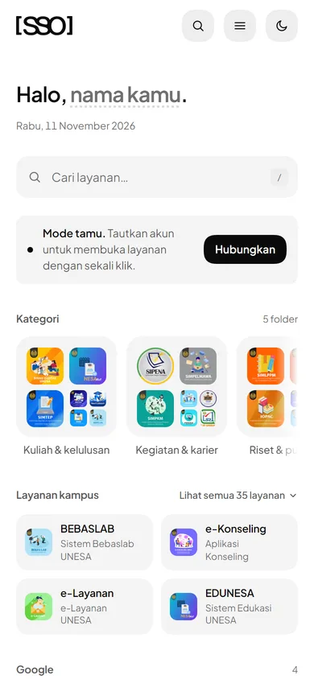

# sso by keroyokan

A small, private, self-hostable launcher for UNESA's SSO dashboard. Not an official UNESA service.

## screenshots

| desktop | mobile |
| --- | --- |
|  |  |

## what it does

- One place for the services behind the SSO dashboard
- Search, keyboard shortcuts, folders, and favorites
- Reorder or hide sections, light or dark
- Guest, link, and cookie modes

## three ways in

- **Guest** - open the app and use the service roots. Nothing to connect.
- **Link** - paste one dashboard app link into `/connect`. The token stays in your browser.
- **Cookie** - desktop or advanced. A server reads the dashboard for you.

## docs

- [Self-hosting](docs/self-hosting.md)
- [Roadmap](roadmap.md)
- [FAQ](public/faq.html)
- [Source](https://github.com/keroyokan-com/sso)
- [Issues](https://github.com/keroyokan-com/sso/issues)

## privacy

- No analytics or CDNs. Fonts are bundled locally.
- Link and token stay in `localStorage`. Cookie mode is server-side only.

## license

MIT. See [LICENSE](LICENSE).
